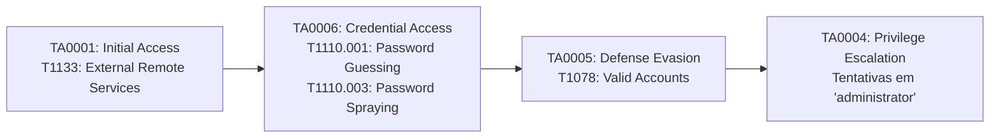

# 03 — Indicadores de Comprometimento (IoCs) e MITRE ATT&CK

Este documento cataloga os artefatos técnicos, indicadores observáveis e o mapeamento de táticas, técnicas e procedimentos (TTPs) vinculados ao ataque investigado.

---

## 1. Tabela de Indicadores de Comprometimento (IoCs)

| Categoria | Indicador / Valor | Contexto / Observação | Ação Recomendada |
| :--- | :--- | :--- | :--- |
| **Endereço IPv4** | `203.0.113.50` | IP externo não autorizado (15 tentativas registradas no host e 2 tentativas bloqueadas no Firewall perimetral). | Bloqueio imediato no Firewall de borda (*Drop*). |
| **Protocolo / Porta** | RDP (TCP 3389) | Serviço de Área de Trabalho Remota exposto publicamente na WAN. | Remoção da publicação direta na internet. |
| **Tipo de Logon** | `Logon Type 10` | Logon remoto interativo registrado nos eventos do Windows. | Proibir para contas não humanas/serviços. |
| **Conta com Acesso Suspeito** | `svc_backup` | Comprometimento presumido: autenticação às 09:18:04 (`Event ID 4624`), pendente de validação forense complementar. | Reset de senha, revogação de sessões e auditoria forense. |
| **Contas Alvo (Varredura)** | `administrator`, `m.silva`, `financeiro` | Contas visadas no ataque de força bruta / *password spraying*. | Notificação aos usuários e checagem preventiva de credenciais. |
| **Nome de Dispositivo** | `UNKNOWN` | Dispositivo de origem mascarado ou sem resolução de nome NetBIOS/DNS. | Flag de anomalia no SIEM. |

---

## 2. Mapeamento no Framework MITRE ATT&CK

O alinhamento às matrizes globais de segurança defensiva permite classificar cada ação do atacante segundo seu objetivo tático:

### Detalhamento das Técnicas:

1. **Acesso Inicial (*Initial Access*) — [T1133](https://attack.mitre.org/techniques/T1133/):**
   * *External Remote Services:* O invasor utilizou serviços de acesso remoto expostos na borda da rede corporativa (RDP sobre a porta 3389) como porta de entrada.
2. **Acesso a Credenciais (*Credential Access*) — [T1110](https://attack.mitre.org/techniques/T1110/):**
   * *Brute Force / Password Guessing (T1110.001):* Tentativas automatizadas sucessivas testando listas de senhas (*wordlists*).
   * *Password Spraying (T1110.003):* Rotação entre múltiplos usuários (`administrator`, `m.silva`, `financeiro`, `svc_backup`) para testar combinações comuns.
3. **Evasão de Defesa & Persistência (*Defense Evasion*) — [T1078](https://attack.mitre.org/techniques/T1078/):**
   * *Valid Accounts:* O uso de uma credencial legítima obtida com sucesso permite ao invasor camuflar seu tráfego malicioso em meio às atividades autorizadas da rede.
