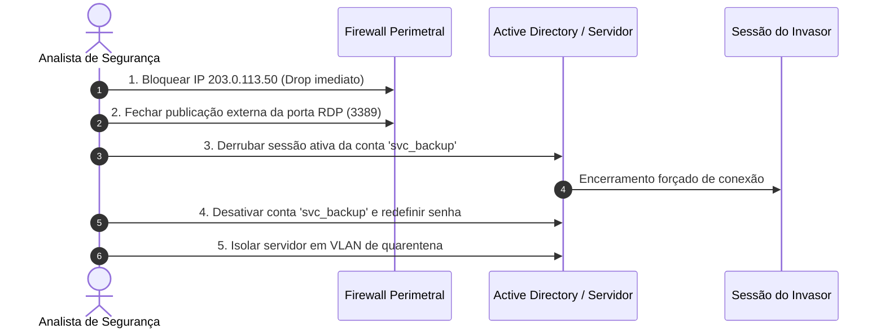

# 04 — Medidas Técnicas de Contenção e Erradicação

Este documento detalha o protocolo técnico executado imediatamente após a identificação do acesso presumidamente não autorizado à conta `svc_backup` às 09:18:04, priorizando o estancamento da ameaça e a preservação de evidências.

---

## 1. Ações Imediatas de Contenção (Janela: Primeiros 15 Minutos)

### Ação 01: Fechamento Perimetral e Bloqueio de Origem (Firewall / Borda)
* **Bloqueio do IP Atacante:** Inclusão imediata da regra de descarte (*DROP*) para todo tráfego de entrada e saída originado de `203.0.113.50`.
* **Cessação do Acesso Externo RDP:** Fechamento das regras de NAT/Port Forwarding da porta **TCP 3389** voltadas para a WAN pública. 
* **Justificativa Operacional:** Impede instantaneamente novas conexões do atacante e mitiga qualquer tentativa de força bruta contra outras contas corporativas.

### Ação 02: Interrupção da Sessão e Contenção de Identidade
* **Desconexão Forçada da Sessão Maliciosa:** Execução de comando administrativo para finalizar a sessão RDP ativa associada ao usuário `svc_backup` (`logoff <session_id>` / PowerShell `Disconnect-RDUser`).
* **Desativação Temporária da Conta:** Bloqueio emergencial da conta `svc_backup` no diretório de usuários.
* **Redefinição de Credencial:** Substituição da senha por uma cadeia aleatória complexa de alta entropia ($\ge 25$ caracteres), neutralizando qualquer efetividade da *wordlist* utilizada no ataque de força bruta.

### Ação 03: Isolamento Lógico da Estação/Servidor
* **Isolamento de Rede:** Movimentação do servidor para uma **VLAN de Quarentena** isolada ou aplicação de regra de isolamento de host (*Host Isolation* via EDR/Firewall local), mantendo apenas comunicação com a máquina de análise forense.
* **Continuidade do Negócio vs. Segurança:** Conforme diretriz operacional, a máquina **não foi desligada bruscamente da tomada**, garantindo:
  1. Que a memória volátil (RAM) não fosse perdida para a perícia digital;
  2. Que os serviços internos essenciais não sofressem corrupção de banco de dados;
  3. Que o atacante ficasse contido em um ambiente restrito sem comunicação lateral com outros servidores.

---

## 2. Medidas de Erradicação e Validação Forense (15 min a 2 horas)

1. **Varredura por Mecanismos de Persistência:**
   * Auditoria de tarefas agendadas (*Task Scheduler*) criadas após as 09:18:00.
   * Checagem de novas chaves de registro em `Run` / `RunOnce`.
   * Inspeção de contas locais criadas recentemente ou adições a grupos privilegiados (`Administrators`).
2. **Coleta de Evidências Voláteis:**
   * Extração de cópia forense da memória RAM e exportação íntegra dos logs de auditoria do Windows (`Security.evtx`, `System.evtx`).
3. **Auditoria de Integridade dos Backups:**
   * Como a credencial comprometida pertencia à rotina de backup (`svc_backup`), foi realizada verificação imediata para assegurar que os repositórios e cópias de segurança não foram adulterados ou criptografados.

---

## 3. Critérios para Retorno Seguro à Operação (Recuperação)

A liberação do ambiente para produção condicionou-se ao cumprimento estrito dos seguintes requisitos:
* [x] Nenhum tráfego malicioso detectado nas últimas 4 horas.
* [x] Remoção definitiva da exposição da porta RDP na internet pública.
* [x] Reconfiguração da conta de serviço `svc_backup` com a diretiva de segurança que **proíbe explicitamente o logon interativo (Deny log on locally / Deny log on through Remote Desktop Services)**.
* [x] Acesso remoto administrativo permitido unicamente por meio de túnel VPN corporativo criptografado com **Autenticação Multifator (MFA)** ativa.
