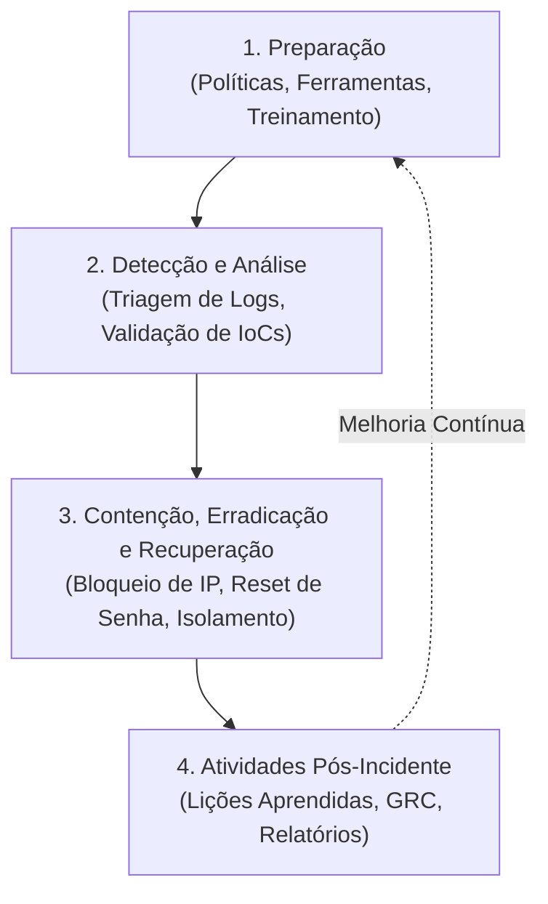

# 04 — Plano de Resposta a Incidentes (NIST SP 800-61 Rev. 3)

Este documento estabelece o fluxo estruturado de Resposta a Incidentes de Segurança da Informação adotado na **TechSolutions Ltda.**, seguindo as diretrizes do **NIST SP 800-61 Rev. 3** (*Computer Security Incident Handling Guide*, publicado em abril de 2025), que integra a resposta a incidentes ao gerenciamento de riscos e ao **Cybersecurity Framework (CSF) 2.0**.

---

## 1. Estrutura do Ciclo de Vida do Incidente

---

## 2. Fases Operacionais do Plano

### Fase 1: Preparação (*Preparation*)
* Manutenção de registros de auditoria centralizados e com sincronização de relógio (NTP).
* Canais de comunicação de emergência fora de banda (*out-of-band*), caso os e-mails corporativos sejam comprometidos.
* Procedimentos operacionais padrão (POPs) para bloqueio emergencial de portas e contas.

### Fase 2: Detecção e Análise (*Detection & Analysis*)
* **Identificação do Gatilho:** Alerta de volume anômalo de eventos `4625` (falhas) originados de IP externo.
* **Confirmação do Acesso Suspeito:** Identificação do evento `4624` (sucesso) às 09:18:04 na conta `svc_backup`. Classificado como **comprometimento presumido** com forte evidência de acesso não autorizado, pendente de validação forense complementar (Session ID, processo de logon e atividade pós-autenticação).
* **Classificação de Severidade:** **Nível 1 (Crítico)** devido ao acesso efetivo de credencial privilegiada.

### Fase 3: Contenção, Erradicação e Recuperação (*Containment, Eradication & Recovery*)
* **Contenção Imediata:** Ações para impedir a continuidade da sessão e propagação lateral (detalhadas no documento de medidas de contenção).
* **Erradicação:** Identificação e expurgo de eventuais chaves de persistência, processos maliciosos e revisão de privilégios.
* **Recuperação:** Restauração dos serviços sob estrito monitoramento de tráfego e regras de acesso restritivas.

### Fase 4: Atividades Pós-Incidente (*Post-Incident Activity*)
* Reunião de lições aprendidas com os times técnico, executivo e de conformidade.
* Documentação técnica formal e elaboração do resumo executivo.
* Avaliação de necessidade de comunicação regulatória (LGPD / ANPD) com apoio do DPO e Jurídico.

---

## 3. Matriz de Responsabilidades (Comitê de Crise)

| Papel | Responsabilidade Principal | Titular no Incidente |
| :--- | :--- | :--- |
| **Líder de Resposta a Incidentes** | Coordenação geral, tomada de decisão e priorização técnica. | Analista de Segurança / Blue Team |
| **Administrador de Sistemas / Redes** | Execução técnica dos bloqueios de firewall, switches e servidores. | Equipe de TI / Infraestrutura |
| **DPO / Jurídico** | Análise de impactos de privacidade, risco a dados pessoais e comunicação à ANPD. | Encarregado de Dados (DPO) |
| **Diretoria / Gestão Executiva** | Aprovação de paradas de serviço e alocação de recursos extraordinários. | C-Level / Gerência de Operações |
