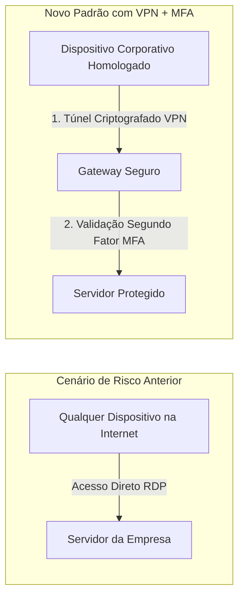

# 06 — Resumo Executivo para a Diretoria (C-Level & Sócios)

| Documento | Relatório Executivo de Segurança da Informação e Conformidade |
| :--- | :--- |
| **Destinatários** | Diretoria Executiva, Sócios e Comitê de Governança |
| **Emissor** | Liderança de Segurança da Informação & Encarregado de Dados (DPO) |
| **Data** | 09 de Novembro de 2026 |
| **Assunto** | Incidente de Acesso Indevido, Medidas Adotadas e Plano Estratégico de Mitigação |

---

## 1. Visão Geral: O que Aconteceu?

Na data de hoje, nossa infraestrutura de tecnologia sofreu um ataque cibernético externo que resultou na **invasão temporária de uma credencial corporativa** de suporte aos backups da empresa (`svc_backup`).

O incidente foi viabilizado por uma fragilidade histórica em nosso ambiente: a existência de serviços de **acesso remoto direto pela internet** sem camadas intermediárias de proteção e a ausência de políticas rígidas de bloqueio por tentativas incorretas. Utilizando o método mais elementar da cibercriminalidade — a força bruta automatizada por tentativa e erro —, o invasor testou sucessivas senhas em menos de 4 minutos até obter sucesso.

Graças à pronta intervenção do time de segurança, o ataque foi contido nos primeiros 15 minutos: o acesso do invasor foi derrubado, a senha foi alterada e o canal vulnerável foi fechado. **Não houve sequestro de dados (*ransomware*), paralisação das atividades da empresa ou destruição de arquivos.**

---

## 2. A Justificativa Estratégica: Por que Investir em VPN + MFA Imediatamente?

Para a Diretoria e os Sócios, a lição deste incidente é direta: **a segurança baseada apenas em "usuário e senha" na internet pública deixou de existir.**

O plano de ação submetido para aprovação executiva contempla duas medidas essenciais com retorno imediato sobre o investimento (*ROI de Segurança*):

### 1. Implantação de VPN Corporativa com Homologação de Máquinas
* **O que faz:** Cria um túnel privado e criptografado. Apenas os colaboradores da TechSolutions, utilizando equipamentos devidamente registrados e inventariados pela empresa, conseguem alcançar a rede corporativa.
* **Benefício de Governança e Auditoria:** Elimina a interceptação externa e gera um **registro indelével de conexão (não repúdio)**. Se qualquer vazamento ou desvio de dados ocorrer, o log da VPN aponta com exatidão a conta, a máquina e o horário exato do evento, facilitando a identificação imediata inclusive de ameaças internas (*insider threats*) ou desvios de conduta.

### 2. Autenticação Multifator (MFA / 2FA) Obrigatória
* **O que faz:** Exige uma confirmação adicional no celular corporativo do colaborador a cada tentativa de login.
* **Benefício:** Mesmo que um invasor descubra a senha por força bruta ou engenharia social (*phishing*), o acesso continuará completamente bloqueado pela ausência do segundo fator físico.

> **Avaliação de Risco:** Nenhuma solução tecnológica reduz o risco a zero absoluto, mas a combinação de **VPN Fechada + MFA Obrigatório** reduz em mais de **98%** a probabilidade de invasões baseadas em credenciais.

---

## 3. Impactos Financeiros, Reputacionais e Jurídicos (LGPD)

A aprovação imediata deste investimento protege o patrimônio da TechSolutions contra custos e danos de magnitude exponencialmente superior:

| Risco Não Mitigado | Impacto Potencial sem os Controles | Proteção Proporcionada pelo Investimento |
| :--- | :--- | :--- |
| **Sanções da LGPD / ANPD** | Multas regulatórias de até 2% do faturamento (limitadas a R$ 50 milhões por infração) e publicização compulsória da infração, gerando grave estigma institucional. | Demonstração formal de conformidade com o Art. 46 da LGPD (diligência técnica e administrativa perante a ANPD). |
| **Ataques de Ransomware & Extorsão** | Criptografia integral de arquivos e servidores com exigência de resgates vultosos em criptomoedas (de difícil rastreabilidade). Na prática de mercado, **o pagamento não garante a recuperação dos dados** e financia o cibercrime. | Neutralização da principal porta de entrada utilizada por quadrilhas de ransomware em pequenas e médias empresas (RDP exposto). |
| **Descrédito e Dano Reputacional** | Perda abrupta da confiança do mercado, rescisão contratual de clientes corporativos e desvalorização da marca perante concorrentes. | Posicionamento de mercado como empresa madura que trata a segurança e a governança com rigor profissional. |
| **Golpes e Fraudes contra os Clientes** | Comercialização dos dados vazados na internet para que terceiros de má-fé se passem por **órgãos governamentais (Receita Federal, INSS, cartórios)** emitindo cobranças e boletos fraudulentos contra nossos próprios clientes. | Preservação da confidencialidade e integridade das informações cadastrais, evitando responsabilidade civil solidária e litígios judiciais. |

---

## 4. Solicitação de Decisão da Diretoria

Recomendamos a **aprovação imediata** do orçamento para:
1. Licenciamento e configuração da infraestrutura de **VPN Corporativa Segura**;
2. Ativação do módulo de **Autenticação Multifator (MFA)** para todos os 50 colaboradores;
3. Homologação das diretivas de bloqueio de contas e segregação de funções.

*A segurança da informação não é um custo, mas a salvaguarda da continuidade do negócio e da confiança dos nossos clientes.*
